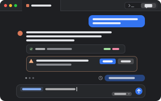

# Agents

<p align="center"></p>

Coding agents in pumi's tabs, in one plugin. A pane's `+` menu opens each agent installed here,
in its own terminal or in a GUI; pumi sees when it works, waits on you or is done; and it is
told about the sessions, panes and tabs around it. Each agent is a [sub-plugin](#sub-plugins): it
ships one per agent, and you can install more or write your own.

```sh
pumi plugin add pumi-dev/plugins/agents
```

Settings → Agents has one switch per agent:

| | What opens | Agents |
| --- | --- | --- |
| Terminal | the agent's own screen; the tab's button flips it to a chat over it and back | all |
| GUI | a chat tab that runs the agent over its SDK, else ACP | pi, Codex, Claude Code (SDK); Gemini, OpenCode, Copilot, Kiro (ACP) |
| Off | nothing: it is left out of the `+` menu, its tabs are left alone and its hook taken out | all |

*Open agents in* under them sets every agent at once (those Off stay off): Terminal, GUI (SDK) or
GUI (ACP). It also picks which a GUI tries first for agents that have both (pi, Codex, Claude
Code); an agent with only one uses that one.

It takes over from Chat UI (`pumi_dev/chat-ui`) and the workspace context plugin
(`amresyd/agents`): their options carry over the first time it starts, and Chat UI's open chat
tabs each time it starts while Chat UI is off.

## A chat over the terminal

Nothing restarts and nothing is screen-scraped. The chat reads the session file the agent writes
and types what you send into its terminal, which keeps running underneath. **Terminal** gives it
back exactly as it was.

- **Send while it works**: prompts queue in the chat and go in order when the agent is ready.
  Stop sends Escape. Queued prompts reach Claude Code and pi at their turn's end through the stop
  hook, rather than typed once the agent is idle.
- **`@` for files and tabs**: lists the other tabs by title, then the agent's project
  (`.gitignore`d files left out): its directory, or its session's when the agent runs in the
  home folder. Pick one to add it to the prompt. A file or a tab in the prompt shows as a chip,
  and Backspace takes it whole; the agent reads a tab named `@tab:%3` with `pumi tab read`.
- **`/` for commands**: the agent's own, plus Claude's `.claude/commands` and skills, Codex's
  prompts, and pi's prompt templates and skills. A command that opens a screen of the agent's own
  (`/model`, `/resume`) shows the terminal.
- **Pictures**: drop one on the chat or the prompt to attach it to the next prompt. It stays in
  the line as a chip, in the prompt and in the sent message; hover it to see the picture.
- **Nothing typed is lost**: the draft stays when the tab flips to the terminal and back, and is
  kept in the tab across a restart of the app. The prompts sent are kept too: ↑ brings them back,
  even after a session that never started.
- **Continue** after a turn that was stopped, failed or cut off goes on without a message to type.
- **Scrolling**: the chat follows the answer while you are at its foot and stays where you read
  when you scroll up; a button takes you back down.
- **Model picker** beside Send, for Claude Code and pi.
- **Permission prompts** as cards you answer in the chat (Claude's, with "Answer permissions in
  pumi" on).
- **Edit a message** you sent: click it, change it, Enter. pi goes back to that exact message
  (through a small pi extension the plugin installs on first use, `~/.pi/agent/extensions/pumi-chat.ts`);
  Claude Code and Codex open their own rewind.

The tab's toolbar has the button; *Agents: flip the focused tab between the terminal and the chat*
is in the palette.

## GUI tabs (SDK and ACP)

The plugin runs the agent itself, under a small host process per tab (`src/session/host.ts`), so
the agent keeps running when the window closes and the tab finds it again. The host speaks ACP, or
the agent's own protocol, and the chat draws what it says as it is written: text token by token,
calls with their output, permission requests and an agent's questions as cards, its models in the
picker. A tab with a session continues it after a restart. The chat shows at once, while the agent
starts: a prompt sent then goes as soon as it is ready.

- *Agents: continue this agent in its GUI* hands a terminal agent's session to a GUI tab, once
  its turn is over.
- The toolbar's terminal button, or *Agents: continue this chat tab's session in the agent's
  terminal*, goes back to the TUI on the same session.
- ACP adapters that aren't installed are fetched with `npx` at a pinned version.
- **Questions** pi (`ask_user_question`) and Codex ask are answered in their card: a choice,
  several, or words of your own.
- **Skills anywhere in the prompt**: `/` after a space lists the agent's skills (pi's own list,
  Codex's `skills/list`, Claude's `.claude/skills` from the project up and in the home folder).
  A picked skill is a chip; on send the host puts its `SKILL.md` before the prompt, as pi does
  for `/skill:name`.
- **Claude Code's GUI over the SDK** runs your installed `claude` through Anthropic's Agent SDK, signed
  in as it is. Anthropic asks apps built on the Agent SDK to sign in with an API key; on a Pro or
  Max sign-in this use may be billed as extra usage. Its row says so while its GUI runs the SDK.
  The chat over its terminal runs the unmodified `claude`, which has no such question.

## Hooks

The plugin puts each agent's hook into the agent's own config by itself (Claude Code's
`~/.claude/settings.json`, Codex's `~/.codex/hooks.json`, pi's extension
`~/.pi/agent/extensions/pumi-context.ts`, …) for every agent installed here that isn't Off, and
keeps it up to date; it takes it out when the agent is set to Off, or all of them when *Connect
agents to pumi* is off. An agent running then picks the change up when it starts again. The
user's own hooks there are left as they are, and the first copy of a config is kept as
`.pumi-bak`. A hook runs only in a terminal opened for its agent, which has `PUMI_AGENT` set:

```sh
pumi call pumi_dev.agents.open claude [cwd]   # an agent tab, as Settings says
```

An agent's terminal is the plugin's own block, `pumi_dev.agents.term`, on pumi's terminal engine:
a terminal like any other, kept across a restart, drawn as the chat or as the terminal. A shell in
a plain terminal that starts an agent is not an agent tab: its hook does nothing there.

The hook tells the plugin the agent's session, model and session file, and its state (the tab's
`@status`); the tab shows the agent's mark (`@icon`) and, when the tab comes back after a restart,
resumes the session (`restore_command`).

## Workspace context

At its start and with each prompt after, an agent is told about the workspace it is in, unseen by
you: a short guide to pumi (`context/guide.md`) and a map of the sessions, views, panes and tabs
around it, then only what changed.

```text
<pumi-context from="pumi_dev/agents">
<pumi>
You are in a tab of pumi, a terminal workspace. …
</pumi>
<pumi-panes>
$7 app (current)
  @3 main (current)
    :11 (focused)
      %129 π - Fix the build — ~/src/app — done (current)
    :12
      %130 zsh — ~/src/app/src
</pumi-panes>
</pumi-context>
```

The map's ids are pumi's: `$1` a session, `@2` a view, `:4` a pane, `%3` a tab. `(current)` marks
where you are. A terminal agent hears it through its hook (Claude's `additionalContext`, pi's
hidden message, OpenCode's system prompt); a GUI tab's host puts it ahead of the prompt.
After a compaction the agent is told everything again.

## For other plugins and agents

An agent tab is one with the plugin's trait, `@pumi_dev.agents.agent` (the agent's id; its fields
`.session`, `.model`, `.transcript`, `.accepts`, `.conversation`), and its status is the tab's
`@status`. Every agent tab serves its conversation as `pumi_dev.agents.conversation.read(tab,
since?)`, `.send(tab, command)` and the `.changed` event; `pumi_dev.agents.queue(tab, text)` is a
prompt for it after its turn, which is how one agent asks another.

## Keys

⇧⌘C flips the focused agent tab between its terminal and the chat; change it on the Keybindings
page. The rest work wherever the keyboard is in the chat.

| | |
| --- | --- |
| Enter, Shift+Enter | send; a new line |
| Esc | close the `/` or `@` list, or the edit; else stop the agent while it works |
| ↑ / ↓ | in an empty prompt, the prompts you sent before, and back |
| ↑ ↓ Tab Enter | in the `/` or `@` list, move and pick |
| ⌃1 … ⌃9 | answer the waiting permission with its first … ninth button |

## Options

Settings → Agents, one page.

| | |
| --- | --- |
| Agents | one row per agent installed here: Off, Terminal or GUI, and whether it is connected |
| Open agents in | sets every agent to Terminal, GUI (SDK) or GUI (ACP); a GUI tries this one first (Terminal) |
| Connect agents to pumi | the agents' hooks, put in and kept up to date by the plugin (on) |
| Answer permission prompts in pumi | Claude Code's permission prompts come to pumi; unanswered in two minutes, Claude asks itself (off) |
| Tell agents about my workspace | the guide and the map (on) |

A chat reads the last 4 MB of a session file, and the map has your other sessions' tabs too.

## Limits

- In a chat over the terminal, a reply shows as each message is written to the session file, not token by
  token, and the mode can't be changed from the chat, nor Codex's model: those pickers are the TUI's.
- In GUI tabs, going back to an earlier message is the agent's own, in its terminal; and
  the agent's own list of sessions to pick from is ACP's only.
- An agent without its hook is taken to be ready 15 s after a prompt, so a queued prompt may
  arrive while it still works.
- A hook hands its input to `pumi call` as one argument: an input past the system's argument limit
  (128 KB on Linux; a permission to write a big file) fails, and the agent asks in its own prompt.
- What an agent was told is kept in memory: after the plugin starts again, an agent's next prompt
  hears the whole map again.

## Sub-plugins

Every agent comes from a sub-plugin: pumi installs, lists and turns them on and off, and the plugin
loads them. It ships one per agent in `agents/` (`agents/claude/`, `agents/pi/`, …), and any other
installed for it adds its own. Settings → Agents lists them under *Sub-plugins*, each with its
switch, and *Browse* finds more in the store. Turn one off and its agents leave the `+` menu,
Settings and their hooks; turn it on and they are back.

```sh
pumi plugin add someone/agents-zed      # a sub-plugin from GitHub: its parent is pumi_dev/agents
pumi plugin dev ./agents-zed            # yours, read again on save
```

A sub-plugin is a folder with a `package.json` whose `pumi` names this plugin as its `parent`, at
`parentApi` 1, and says what it gives:

```json
{
  "name": "agents-zed",
  "displayName": "Zed Agent",
  "main": "src/index.ts",
  "pumi": {
    "name": "agent-zed",
    "parent": "pumi_dev/agents",
    "parentApi": 1,
    "agents": [{
      "id": "zed", "title": "Zed Agent", "program": "zed-agent", "icon": "icon.svg",
      "resume": ["zed-agent", "--resume", "{session}"],
      "acp": { "run": [["zed-agent", "--acp"]], "login": ["zed-agent", "login"] },
      "sdk": "zed",
      "hook": { "shape": { "kind": "hooks", "file": ".zed/settings.json", "start": "SessionStart", "stop": "Stop", "ms": false } },
      "chat": { "format": "zed", "cancel": "\u001b", "images": "text", "home": ".zed", "rewind": "backtrack" }
    }],
    "formats": ["zed"],
    "engines": { "zed": { "module": "src/engine.ts", "run": ["{program}", "--rpc"], "session": ["--session", "{session}"] } }
  }
}
```

| Key | |
| --- | --- |
| `agents` | Each agent: its `id` (the trait's, `modes`'s key), `title`, `program`, and what it has. `label` is what its chat and prompts call it; `rank` its place in the `+` menu (the shipped ones are 10 to 140); `default` its choice (`terminal`). `resume` is its TUI on a session, for *back*; `acp` how its ACP server starts; `sdk` the engine its GUI runs it with. `hook` is how its hook goes in (`shape`: `hooks`, merged into a JSON config as Claude Code's; `cursor`; or `file`, a `template` of the sub-plugin with `{fn}` and `{agent}` filled in), with `reports`, `restore` (the tab's `restore_command`) and `accepts`. `chat` is how the chat over its terminal reads it: the `format` of its session files, the key that cancels, how pictures go in, its `home` and how it goes back to a message. |
| `formats` | The session-file formats its `main` module reads. The module exports `formats`, a `FormatDef` each: its `parser()`, where a session's file is (`locate`), and the `models`, `builtins` and `fileCommands` the chat offers. |
| `engines` | The engines a GUI tab's host runs an agent with beside ACP: a `module` exporting `createDriver(spec, write, events)`, the server it runs (`run`, `{program}` filled in, and `session` to continue one), or `process: false` for one that runs the agent in the host. |

Its code imports what it builds with from `@pumi-dev/agents`: the conversation (`Producer`,
changes, the model), the parsers' helpers, the slash commands' and the types (`src/api.ts`, which
the ones in `agents/` import by path). The plugin's worker resolves it, and so does each GUI tab's
host. An agent's chat needs a sub-plugin that is on to read its format: omp's is pi's, so omp's
chat is there while pi's sub-plugin is on.

## Development

```sh
pumi plugin dev agents   # link it, reload on save
bun test                 # the sub-plugins, the parsers, the conversation model, mentions, commands, keys, the hosts, the hooks, the context
```

The tests run on synthetic records shaped like each agent's files; no real session is in them, and
each starts with the sub-plugins in `agents/` loaded (`test/setup.ts`). `src/conversation/` is the
agent-agnostic conversation (the model, its changes, the chat's drawing), `src/bridge.ts` follows
one terminal tab, and each format's parser turns an agent's session file into it
(`agents/claude/src/parse.ts`, …). `src/subplugins.ts` loads the sub-plugins into `src/registry.ts`,
and `src/catalog.ts` says how each agent opens; `src/sessions.ts` runs the ACP and SDK tabs, and
`src/session/` is their host, with ACP's engine and the sub-plugins' (`agents/pi/src/engine.ts`, …).
`src/hooks/` is the agents' hooks (the merge and the files, `integrations.ts`; what the hook
function answers, `hook.ts` and `run.ts`), and `src/context/` with `src/tell.ts` is what an agent is
told about the workspace.
