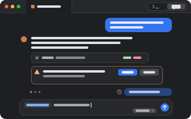

# Agents

<p align="center"></p>

Coding agents in pumi's tabs, in one plugin. A pane's `+` menu opens each agent installed here,
in its own terminal or as a chat; pumi sees when it works, waits on you or is done; and it is
told about the sessions, panes and tabs around it.

```sh
pumi plugin add pumi-dev/plugins/agents
```

Settings → Agents has one switch per agent:

| | What opens | Agents |
| --- | --- | --- |
| Terminal | the agent's own screen; the tab's button flips it to a chat and back | all |
| Chat | the agent as a chat | Claude Code, Codex, pi, omp, Gemini, OpenCode, Copilot, Kiro |
| Off | nothing: it is left out of the `+` menu, its tabs are left alone and its hook taken out | all |

A chat is the agent's own terminal with the chat drawn over it where the plugin reads the agent's
session file (Claude Code, Codex, pi, omp), else a chat tab that runs the agent's ACP server.
*Agents: continue this agent in a chat tab* also hands pi, Codex or Claude Code to a tab that runs
it over its own protocol (an SDK).

It takes over from Chat UI (`pumi_dev/chat-ui`) and the workspace context plugin
(`amresyd/agents`): their options carry over the first time it starts, and Chat UI's open chat
tabs each time it starts while Chat UI is off.

## A chat over the terminal

Nothing restarts and nothing is screen-scraped. The chat reads the session file the agent writes
and types what you send into its terminal, which keeps running underneath. **Terminal** gives it
back exactly as it was.

- **Send while it works**: prompts queue in the chat and go in order when the agent is ready.
  Stop sends Escape. Queued prompts reach Claude Code and pi at their turn's end through the stop
  hook, rather than typed once the agent is idle.
- **`@` for files**: lists the agent's directory (`.gitignore`d files left out); pick one to add
  it to the prompt. A file in the prompt shows as its icon and name, and Backspace takes it whole.
- **`/` for commands**: the agent's own, plus Claude's `.claude/commands` and skills, Codex's
  prompts, and pi's prompt templates and skills. A command that opens a screen of the agent's own
  (`/model`, `/resume`) shows the terminal.
- **Pictures**: drop one on the chat or the prompt to attach it to the next prompt.
- **The draft stays** when the tab flips to the terminal and back.
- **Model picker** beside Send, for Claude Code and pi.
- **Permission prompts** as cards you answer in the chat (Claude's, with "Answer permissions in
  pumi" on).
- **Edit a message** you sent: click it, change it, Enter. pi goes back to that exact message
  (through a small pi extension the plugin installs on first use, `~/.pi/agent/extensions/pumi-chat.ts`);
  Claude Code and Codex open their own rewind.

The tab's toolbar has the button; *Agents: flip the focused tab between the terminal and the chat*
is in the palette.

## Chat tabs (ACP and SDK)

The plugin runs the agent itself, under a small host process per tab (`src/session/host.ts`), so
the agent keeps running when the window closes and the tab finds it again. The host speaks ACP, or
the agent's own protocol, and the chat draws what it says as it is written: text token by token,
calls with their output, permission requests and an agent's questions as cards, its models in the
picker. A tab with a session continues it after a restart.

- *Agents: continue this agent in a chat tab* hands a terminal agent's session to a chat tab,
  once its turn is over (over ACP when the agent has it, else its SDK).
- The toolbar's terminal button, or *Agents: continue this chat tab's session in the agent's
  terminal*, goes back to the TUI on the same session.
- ACP adapters that aren't installed are fetched with `npx` at a pinned version.
- **Claude Code in a chat tab** runs your installed `claude` through Anthropic's Agent SDK, signed
  in as it is. Anthropic asks apps built on the Agent SDK to sign in with an API key; on a Pro or
  Max sign-in this use may be billed as extra usage. Chat in Settings is the chat over the
  unmodified `claude`, which has no such question.

## Hooks

The plugin puts each agent's hook into the agent's own config by itself (Claude Code's
`~/.claude/settings.json`, Codex's `~/.codex/hooks.json`, pi's extension
`~/.pi/agent/extensions/pumi-context.ts`, …) for every agent installed here that isn't Off, and
keeps it up to date; it takes it out when the agent is set to Off, or all of them when *Connect
agents to pumi* is off. An agent running then picks the change up when it starts again. The
user's own hooks there are left as they are, and the first copy of a config is kept as
`.pumi-bak`. A hook runs only in a terminal opened for its agent, which has `PUMI_AGENT` set:

```sh
pumi call pumi_dev.agents.open claude [cwd]   # an agent tab, as Settings says
```

An agent's terminal is the plugin's own block, `pumi_dev.agents.term`, on pumi's terminal engine:
a terminal like any other, kept across a restart, drawn as the chat or as the terminal. A shell in
a plain terminal that starts an agent is not an agent tab: its hook does nothing there.

The hook tells the plugin the agent's session, model and session file, and its state (the tab's
`@status`); the tab shows the agent's mark (`@icon`) and, when the tab comes back after a restart,
resumes the session (`restore_command`).

## Workspace context

At its start and with each prompt after, an agent is told about the workspace it is in, unseen by
you: a short guide to pumi (`context/guide.md`) and a map of the sessions, views, panes and tabs
around it, then only what changed.

```text
<pumi-context from="pumi_dev/agents">
<pumi>
You are in a tab of pumi, a terminal workspace. …
</pumi>
<pumi-panes>
$7 app (current)
  @3 main (current)
    :11 (focused)
      %129 π - Fix the build — ~/src/app — done (current)
    :12
      %130 zsh — ~/src/app/src
</pumi-panes>
</pumi-context>
```

The map's ids are pumi's: `$1` a session, `@2` a view, `:4` a pane, `%3` a tab. `(current)` marks
where you are. A terminal agent hears it through its hook (Claude's `additionalContext`, pi's
hidden message, OpenCode's system prompt); a chat tab's host puts it ahead of the prompt.
After a compaction the agent is told everything again.

## For other plugins and agents

An agent tab is one with the plugin's trait, `@pumi_dev.agents.agent` (the agent's id; its fields
`.session`, `.model`, `.transcript`, `.accepts`, `.conversation`), and its status is the tab's
`@status`. Every agent tab serves its conversation as `pumi_dev.agents.conversation.read(tab,
since?)`, `.send(tab, command)` and the `.changed` event; `pumi_dev.agents.queue(tab, text)` is a
prompt for it after its turn, which is how one agent asks another.

## Keys

⇧⌘C flips the focused agent tab between its terminal and the chat; change it on the Keybindings
page. The rest work wherever the keyboard is in the chat.

| | |
| --- | --- |
| Enter, Shift+Enter | send; a new line |
| Esc | close the `/` or `@` list, or the edit; else stop the agent while it works |
| ↑ / ↓ | in an empty prompt, the prompts you sent before, and back |
| ↑ ↓ Tab Enter | in the `/` or `@` list, move and pick |
| ⌃1 … ⌃9 | answer the waiting permission with its first … ninth button |

## Options

Settings → Agents, one page.

| | |
| --- | --- |
| Agents | one row per agent installed here: Off, Terminal or Chat, and whether it is connected |
| Connect agents to pumi | the agents' hooks, put in and kept up to date by the plugin (on) |
| Answer permission prompts in pumi | Claude Code's permission prompts come to pumi; unanswered in two minutes, Claude asks itself (off) |
| Tell agents about my workspace | the guide and the map (on) |

A chat reads the last 4 MB of a session file, and the map has your other sessions' tabs too.

## Limits

- In a chat over the terminal, a reply shows as each message is written to the session file, not token by
  token, and the mode can't be changed from the chat, nor Codex's model: those pickers are the TUI's.
- In chat tabs, going back to an earlier message is the agent's own, in its terminal; and
  the agent's own list of sessions to pick from is ACP's only.
- An agent without its hook is taken to be ready 15 s after a prompt, so a queued prompt may
  arrive while it still works.
- A hook hands its input to `pumi call` as one argument: an input past the system's argument limit
  (128 KB on Linux; a permission to write a big file) fails, and the agent asks in its own prompt.
- What an agent was told is kept in memory: after the plugin starts again, an agent's next prompt
  hears the whole map again.

## Development

```sh
pumi plugin dev agents   # link it, reload on save
bun test                 # the parsers, the conversation model, mentions, commands, keys, the hosts, the hooks, the context
```

The tests run on synthetic records shaped like each agent's files; no real session is in them.
`src/conversation/` is the agent-agnostic conversation (the model, its changes, the chat's drawing),
`src/parse/` turns each agent's session file into it, and `src/bridge.ts` follows one terminal tab.
`src/catalog.ts` lists the agents and how each opens; `src/sessions.ts` runs the ACP and SDK tabs, and
`src/session/` is their host, one engine per protocol. `src/hooks/` is the agents' hooks (the
table and their files, `integrations.ts`; what the hook function answers, `hook.ts` and `run.ts`),
and `src/context/` with `src/tell.ts` is what an agent is told about the workspace.
