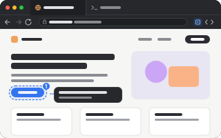

# browser

<p align="center"></p>

A web page in a tab, with back, forward, reload and an address bar over it, and where cmd+click
sends a terminal's links. pumi itself has only the webview (`<WebView>`, `useWebview`), which any
plugin draws pages with; the browser is this plugin.

```sh
pumi plugin add pumi-dev/plugins/browser
```

Without it, a terminal's cmd+clicked links open in the system's browser.

```sh
pumi call pumi_dev.browser.open '{"url":"https://pumi.dev"}'    # beside this tab
pumi call pumi_dev.browser.openView '{"url":"example.com"}'     # in a view of its own
pumi tab open pumi_dev.browser.page '{"url":"https://example.com"}' --split right
```

`open`'s address is its argument (`{ url }`, or a plain string), else `home_url`, else the address
bar.

## Options

| | |
| --- | --- |
| `home_url` | the page a new browser tab opens; empty starts in the address bar |
| `search_url` | the address bar's search engine; `{query}` is what was typed |
| `open_links` | where cmd+click opens a terminal's links: a browser tab (`app`) or the system browser (`system`); shift+cmd+click opens the other |
| `url` | a tab's own: the page it is on. Setting it navigates; the page writes it back as it goes |

Whether pages get their Web Inspector (alt+cmd+i) is pumi's `webview_devtools`, in Settings ▸
Plugins.

## Links from terminals

A terminal's cmd+clicked link goes to `pumi_dev.browser.open` with `{url, tab, link: true, shift}`:
it opens beside that terminal, or in the system's browser when `open_links` says `system` (shift
says the other) or the link is no page (`mailto:`).

## The tab

| | |
| --- | --- |
| the toolbar | back, forward, reload (stop while it loads), the address, the page's name, the picker, devtools |
| the keys | `cmd+l` the address, `cmd+r` reload, `cmd+[` back, `cmd+]` forward, while it has the keyboard |
| the address bar | a URL, a host (`example.com`, `localhost:3000`) as an address, anything else as a search |
| the state | the address is the tab's `url` option and the name is its `title`: tabs that come back come back where they were |

`tab.call` reaches the block's own methods (`navigate`, `back`, `forward`, `reload`) and the
protocol's (`read`, `selection`, `input`):

```sh
pumi tab navigate %3 '{"url":"example.com"}'
pumi tab read %3                             # the name, then the address
pumi tab input %3 --text 'example.com/next'  # typed into the address bar, and Enter
pumi call pumi_dev.browser.back %3           # also forward, reload, navigate, url, title
```

The toolbar has a picker for notes to an agent too, and the package drives the page for one (below).

## For agents

An agent reads and drives the page with the package's functions, each taking the tab and a JSON
object (`pumi help pumi_dev.browser.click` says what one takes). Each is also the block's method
(`tab.call("%3", "click", {…})`). They run in the window that draws the tab, so the tab has to be
shown in one.

```sh
pumi call pumi_dev.browser.snapshot %3                              # headings, text, controls with refs
pumi call pumi_dev.browser.click %3 '{"target":"e12"}'              # a ref, a selector, or {"text":"Sign in"}
pumi call pumi_dev.browser.fill %3 '{"target":"input[name=email]","value":"ada@example.com"}'
pumi call pumi_dev.browser.press %3 Enter
pumi call pumi_dev.browser.waitFor %3 '{"text":"Saved"}'            # or {"load":true}, {"selector":…,"gone":true}
pumi call pumi_dev.browser.eval %3 'document.title'                 # an expression, or a body that returns
pumi call pumi_dev.browser.console %3 '{"level":"error"}'
pumi call pumi_dev.browser.screenshot %3                            # a PNG's path (macOS)
```

| function | what it does |
| --- | --- |
| `snapshot` | the page as text: address, title, scroll, then headings, text, and each link, button and field with a ref (`[e12]`) |
| `text`, `html` | the page's (or one element's) text, or HTML |
| `find` | one element: ref, unique selector, role, name, box, attributes, HTML, ancestors, style, and its source file and components where a React, Vue or Svelte dev build says |
| `click`, `hover`, `fill`, `type`, `press`, `scroll` | what a person does, as DOM events at the element |
| `waitFor` | an element there or gone, or the page loaded |
| `eval` | JavaScript in the page, as its own script; the value as JSON |
| `console` | its console lines and uncaught errors since it loaded (the last 300) |
| `screenshot` | a PNG of what the page shows, in the plugin's cache or at `path` |
| `notes`, `clearNotes` | the user's notes on its elements, below |

Synthetic events are not trusted ones: a page that checks `isTrusted`, or a native control (a file
picker), can tell.

## Notes for the agent

The toolbar's picker (the square, beside devtools) outlines the element under the mouse; a click
takes it (`↑` climbs to its parent, `Esc` gives up), and a bar asks what should change. The notes
stay on the page, outlined and numbered, and in a strip under the toolbar.

An agent reads them with the block's own method, `tab.call(tab, "notes")` (the same as
`pumi call pumi_dev.browser.notes %3`); its `describe` says what they are. Reading them marks them
read, and `clearNotes` (or the strip's Clear) takes them off. Nothing tells an agent the notes are
there: it reads them when it is asked to, or when their `describe` is what it looks at. The notes
are kept with the plugin, so they survive a restart.

What a webview cannot do for it: no profile, cookies, downloads or zoom of its own; a link the page
opens in a new window goes to the system's browser; another site's document is not readable, so
`selection` is empty.

## Development

```sh
pumi plugin dev browser   # link it, reload on save
bun test                  # the address bar's rules
```
