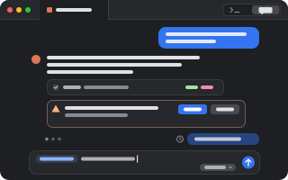

# Chat UI

<p align="center"></p>

A chat view for Claude Code, Codex and pi (or omp) tabs. One click flips the tab between the agent's
own terminal and a chat of the same live session, and back.

```sh
pumi plugin add pumi-dev/plugins/chat-ui
```

Nothing restarts and nothing is screen-scraped. The chat reads the session file the agent writes
and types what you send into its terminal, which keeps running underneath. **Terminal** gives it
back exactly as it was.

- **Send while it works**: prompts queue in the chat and go in order when the agent is ready.
  Stop sends Escape.
- **`@` for files**: lists the agent's directory (`.gitignore`d files left out); pick one to add
  `@path` to the prompt.
- **`/` for commands**: the agent's own, plus Claude's `.claude/commands` and skills, Codex's
  prompts, and pi's prompt templates and skills. A command that opens a screen of the agent's own
  (`/model`, `/resume`) shows the terminal.
- **Pictures**: drop one on the chat to attach it to the next prompt.
- **Model picker** beside Send, for Claude Code and pi.
- **Permission prompts** as cards you answer in the chat (Claude's, with Settings → "Answer
  permissions in pumi").
- **Edit a message** you sent: click it, change it, Enter. pi goes back to that exact message
  (through a small pi extension the plugin installs on first use, `~/.pi/agent/extensions/pumi-chat.ts`);
  Claude Code and Codex open their own rewind.
- **For other plugins**: every agent tab it reads serves its conversation as
  `pumi_dev.chat_ui.conversation.read(tab, since?)`, `.send(tab, command)` and the
  `.changed` event.

The tab's toolbar has the button; *Chat UI: flip the focused tab between the terminal and the chat*
is in the palette.

## Options

Settings → Chat UI.

| | |
| --- | --- |
| Open agents as chats | show every agent tab as a chat as soon as its agent starts (on) |
| Key | a chord that flips the focused agent tab (none) |
| History read | how much of a session file's end is read when the chat opens (4 MB) |

## Limits

- A reply shows as each message is written to the session file, not token by token.
- The mode can't be changed from the chat, nor Codex's model: those pickers are the TUI's.
- An agent without pumi's hook (`pumi skill add …`) is taken to be ready 15 s after a prompt, so a
  queued prompt may arrive while it still works.

## Development

```sh
pumi plugin dev chat-ui   # link it, reload on save
bun test                  # the parsers, finding session files, the conversation model, mentions, commands
```

The tests run on synthetic records shaped like each agent's files; no real session is in them.
`src/conversation/` is the agent-agnostic conversation (the model, its changes, the chat's drawing),
`src/parse/` turns each agent's session file into it, and `src/bridge.ts` follows one tab.
