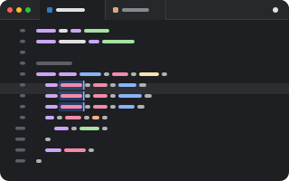

# Code Editor

<p align="center"></p>

A code editor for file tabs, drawn by pumi itself, with no web page. The text, undo, syntax
trees and indentation are CodeMirror 6's.

```sh
pumi plugin add pumi-dev/plugins/code-editor
```

It needs pumi 0.44 or later.

- **Languages**: highlighting and indentation for JavaScript and TypeScript (JSX), JSON, Rust,
  Python, Go, C and C++, Java, CSS, HTML, Markdown and YAML, in the terminal's colours. Any other
  text file opens as plain text.
- **Carets**: several at once (`⌥`-click, `⌥⌘↑`/`⌥⌘↓`, `⌘D`), drag to select (double-click for
  words, triple for lines), word, line and document moves.
- **Editing**: matching brackets, brackets that close themselves, comments (`⌘/`), moving and
  copying lines (`⌥↑`/`⌥↓`, `⇧⌥↑`/`⇧⌥↓`), undo and redo.
- **Typing**: dead keys, press-and-hold accents, input methods (Japanese, Chinese, Korean), the
  emoji picker and dictation, as in any Mac app.
- **Opening**: *File…* in a pane's `+` menu (and the list a split opens with) picks a file and
  opens it in a tab there. The palette has it as *Code Editor: open a file*.
- **Saving**: `⌘S`, or the dot in the tab's toolbar while the file has unsaved changes. The
  palette has it as *Code Editor: save the file*.

Big files stay fast: only the lines in view are drawn, and a line draws again only when its text
or colours change.

## Options

| | |
| --- | --- |
| `tab_size` | columns a tab takes, and the indent for a file that has none yet |
| `insert_spaces` | indent with spaces rather than a tab, for a file that has no indentation yet |

A file's own indentation wins over both.

## Development

```sh
pumi plugin dev code-editor   # link it, reload on save
bun test                      # editing, layout and highlighting
```
