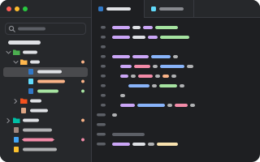

# File Tree

<p align="center"></p>

The project tree in the sidebar: the folders and files of the repository the current tab is in,
with their icons and git's marks. Open, rename, move, trash and search them without leaving pumi.

```sh
pumi plugin add pumi-dev/plugins/file-tree
```

- **The project**: the work tree's root of the tab in front (its own directory outside a
  repository). The tree follows you from tab to tab and keeps each project's open folders.
- **Git's marks**: a new file is green, a changed one is tinted, a deleted one red, a conflict
  yellow, and a folder shows what is under it.
- **Icons**: the [Material Icon Theme](https://github.com/material-extensions/vscode-material-icon-theme)
  (MIT), matched by name and extension the way VS Code matches them, with light icons for a light
  theme.
- **Search**: fuzzy, over the whole project, not only the open folders (`git ls-files` in a
  repository, so ignored files stay out).
- **Files**: new file or folder, rename in place, cut, copy, paste, duplicate, drag and drop,
  trash, delete, add to `.gitignore`, reveal in Finder.
- **Fast on big trees**: folders are read when they open, the rows are windowed, and a build
  writing inside an ignored folder does not redraw anything.

`cmd+shift+e` shows or hides it. The palette has *File Tree: reveal the current file in the tree*
and *File Tree: search the project*.

| Key | |
| --- | --- |
| click, space | open a file; fold a folder |
| right click | the row's menu |
| ↑/↓, `ctrl+n`/`ctrl+p` | move |
| →/← | open or close a folder; `cmd+→`/`cmd+←` everything |
| enter, `f2` | rename |
| `cmd+c`, `cmd+x`, `cmd+v` | copy, cut, paste |
| backspace | trash |
| delete | delete |
| `cmd+f` | search |
| esc | clear the search, drop the cursor |

## Options

| | |
| --- | --- |
| `open_with` | what a click on a file does: `tab` (a view of its own), `beside` (a tab on the right), `editor` (your editor in a terminal tab) or `system` (its app) |
| `editor` | the editor for `open_with = "editor"`: `code -w`, `nvim`, `hx`; empty is `$EDITOR` |
| `hide_gitignore` | leave out what `.gitignore` hides |
| `hide_hidden` | leave out dotfiles |
| `file_icons`, `folder_icons` | draw the icons |
| `git_status` | tint rows by git's state |
| `auto_fold_dirs` | draw a folder that holds one folder as one row, `a/b/c` |
| `indent_size` | pixels per level |

A file opens in whichever enabled viewer fits it best, such as the Code Editor or the CSV
Viewer.

## Development

```sh
pumi plugin dev file-tree           # link it, reload on save
bun test                            # the tree, the sort, .gitignore, git's marks, the file operations
```

It needs `git` on `PATH` for the marks and the search.
