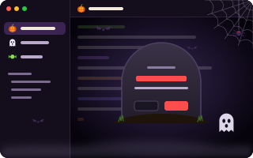

# Halloween

<p align="center"></p>

A UI theme: pumi on Halloween night. The window is night purple lit in pumpkin orange, and the
terminals have a palette to match.

```sh
pumi plugin add pumi-dev/plugins/halloween
pumi option set ui_theme halloween
```

- **Agents**: a tab at work is a jack-o'-lantern that flickers, one that needs you is a ghost
  that bobs, one that failed is a skull that shakes, and one that is done is a sweet.
- **Scares**: when an agent needs you a ghost rises up the window, when one fails lightning
  strikes, and when one finishes a swarm of bats flies out.
- **Questions** (closing a tab, renaming a view) are carved on a gravestone standing in the
  grass. One that ends something reads R.I.P.
- **Menus** are cards of the night with a cobweb in the corner and a pumpkin by the row under
  the mouse.
- **The night**: bats cross the top of the window, a spider climbs up and down its web in the
  corner, and fog drifts along the bottom. None of it takes a click: what is under it still
  gets the press.
- **The rest**: the start screen lights a jack-o'-lantern under the moon, pane edges glow while
  you drag them, a zoomed pane sits on a pumpkin glow, and tooltips are edged in orange.

## Options

Settings → Halloween.

| | |
| --- | --- |
| Bats, cobwebs and the spider | the critters over the window's edges |
| Fog | the fog along the bottom of the window |
| Scares when agents change | the ghost, the lightning and the bats |
| Outline the focused pane | a pumpkin-orange edge on the pane with the focus |

## Development

```sh
pumi plugin dev halloween                   # link it, reload on save
bun test                                    # the parts and the scares, in the test renderer
HALLOWEEN_SHOTS=/tmp/shots bun test         # the same, saving each part as a PNG
rsvg-convert -w 512 tools/icon.svg -o icon.png
```

`themes/halloween/theme.tsx` has the colours, the terminal palette and the tabs' icons;
`parts.tsx` the menu, the gravestone, the buttons, the pane edge and the start screen.
`src/ui.tsx` is the night over the window (the plugin's `window.overlay`), `src/bats.tsx` the bats
and `src/sprites.ts` the art. The title face is [Creepster](https://fonts.google.com/specimen/Creepster)
by Font Diner (SIL Open Font License 1.1, `themes/halloween/fonts/`).
