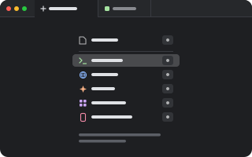

# launcher

<p align="center"></p>

A tab that lists what you can open in it: a file, and the same list as the `+` menu (Terminal's
shell, each agent, Browser's page, …), the most used first, each with a key to press. What you
pick takes the tab's place, in the same pane.

```sh
pumi plugin add pumi-dev/plugins/launcher
```

## New tabs

Pick Launcher in Settings ▸ General ▸ New tabs open (pumi's `new_tab` option,
`pumi_dev.launcher.new`) and every new tab, split, view and session starts as the list. The start
screen does this when Launcher is among the plugins it installs.

## Keys

| Key | |
| --- | --- |
| `F` | a file, from the system's picker |
| a row's letter | that row: the same letter as in the `+` menu (`C` Claude Code, `P` Pi, `T` Terminal…), which stays as the order changes |
| `↑` `↓`, `Enter` | choose one, open it |
| `Escape` | close the tab |

On a pumi before `useNewTabs`, the list is the `tab.new` slot's actions, in order, on `1` … `9`.

## The block

`pumi_dev.launcher.new` takes no arguments. `src/ui.tsx` draws it with the `+` menu's list
(`useNewTabs` from `pumi/theme`), less its own row; `src/kinds.ts` is what the list holds, apart
from drawing it.

## Testing

```sh
bun test
```
