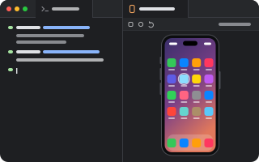

# simulator

<p align="center"></p>

An iOS Simulator in a tab. The simulator is Apple's (`CoreSimulator`); this plugin is the plumbing:
it finds one with `simctl`, boots it, runs [serve-sim](https://github.com/EvanBacon/serve-sim)
beside it, and draws the stream in a webview. Touches, drags, keys and the device's buttons go back
to the device over serve-sim's own websocket, so the tab is a fully interactive simulator, with no
Simulator.app or Xcode window.

```sh
pumi plugin add pumi-dev/plugins/simulator
```

Then **Simulator: open** in the palette (`⌘K`), or `pumi call pumi_dev.simulator.open`.

## What it needs

- **macOS with Xcode**, and an **iOS Simulator runtime** (Xcode ▸ Settings ▸ Components). Nothing
  can boot without one; `xcrun simctl runtime list` says what is installed.
- **Node 20+.** serve-sim's native helper is a Node-API addon, so it runs on Node, not Bun. It is
  found on `PATH`, else in nvm or Homebrew; the `node` option overrides.
- **Apple Silicon.** serve-sim's helper is arm64 only.

The first open installs serve-sim (pinned by the `version` option, `0.1.48` by default) into the
plugin's cache. That takes a few seconds, once.

## How it works

- `src/main.ts` runs in the plugin's worker: `xcrun simctl` for what simulators exist and booting
  them, and one supervised `serve-sim` per booted device, reaped when the last tab showing it
  closes. It reads serve-sim's state file (`$TMPDIR/serve-sim/server-<udid>.json`) for the address
  the streamer actually took, so a streamer someone else started is reused rather than duplicated.
- `src/ui.tsx` draws `<WebView src={url}>` with serve-sim's preview page in it: the stream, the
  device chrome, the toolbar and the input. The page belongs to another server, so it brings its
  own look and does not get `window.pumi`.
- Nothing native is added to pumi. The native part (CoreSimulator, IOSurface capture, VideoToolbox
  H.264, Indigo HID) is inside serve-sim's helper, which is a process this plugin spawns.

Streams bind to `127.0.0.1` only. serve-sim's preview server also has a token-gated shell-exec
route: this plugin never proxies it, and nothing should.

## Options

| option | default | |
| --- | --- | --- |
| `udid` | none | a tab's own: the device it shows (a udid or a name) |
| `port` | `3210` | the first port serve-sim may take; it moves up when one is busy |
| `version` | `0.1.48` | the serve-sim release installed into the plugin's cache |
| `node` | found | the node binary that runs serve-sim |
| `keepalive` | `120` s | how long the streamer stays up after its last tab closes |

## Commands and API

- **Simulator: open** boots the booted (or first usable) device and opens a tab beside the current
  one.
- **Simulator: stop streaming** stops every streamer this plugin started.
- **Simulator: screenshot** takes a PNG of the device's screen and shows it in a tab.

For agents and other plugins (`pumi registry list fn | grep simulator`). The plugin activates on
startup, so these exist as soon as the app is up, with no tab open:

```sh
pumi call pumi_dev.simulator.devices                              # [{ udid, name, runtime, state, available }]
pumi call pumi_dev.simulator.stream '{"device":"iPhone 18 Pro"}'  # { url, streamUrl, wsUrl, port }
pumi call pumi_dev.simulator.screenshot '{"device":"iPhone 18 Pro"}'
pumi tab open pumi_dev.simulator.device '{"pumi_dev.simulator.udid":"iPhone 18 Pro"}' --split right
```

`device` is a udid or a name, and the booted device when it is left out. `screenshot` answers the
path to a PNG, so an agent can read the device's screen without a tab open. `stream` starts the
streamer if it is not up; `streamUrl` is a plain `multipart/x-mixed-replace` MJPEG body, which
anything can read.

## What to know

- **Closing the app stops every streamer** (`keepalive` aside), and a worker reload kills what the
  previous run started, from a record in the plugin's state directory (`helpers.json`).
- **Xcode 27 keyboard input** goes through Xcode's Device Hub: serve-sim needs it running with the
  simulator window frontmost, and macOS may ask for Accessibility for the app that launched pumi.
  Touches do not need any of that. `SERVE_SIM_DISABLE_DEVICE_HUB_KEYBOARD=1` opts out.
- **A device that shuts down** takes its streamer with it (`--exit-on-simulator-shutdown`); the
  tab keeps the last frame until you retry.
- **iPhone Duo** (Xcode 27.1 + iOS 27.1) gets serve-sim's folded, semi-folded and open controls and
  its RealityKit shell in the same tab, because the shell is part of the preview page.
- **"The streamer is still running"** is usually `keepalive`, or a streamer listed in
  `$TMPDIR/serve-sim/`. `pumi plugin logs simulator` shows serve-sim's own output, which the tab
  also prints when the streamer fails to come up.

## Development

```sh
pumi plugin dev simulator   # link it, reload on save
bun run check               # types
```
