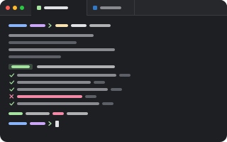

# terminal

<p align="center"></p>

A shell in a tab. pumi itself runs terminals (the PTY, the program, its screen and scrollback,
and keeping them alive across a restart) for any block that asks for them; the terminal is this
plugin: the block a tab runs a shell in, and what draws it.

```sh
pumi plugin add pumi-dev/plugins/terminal
```

```sh
pumi call pumi_dev.terminal.open                                  # a shell beside this tab
pumi call pumi_dev.terminal.open '{"command":["make","test"]}'    # a program instead
pumi tab open pumi_dev.terminal.shell '{"cwd":"/src"}' --split right
```

## New tabs

The plugin doesn't change what a new tab opens. Pick Terminal in Settings ▸ General ▸ New tabs
open (pumi's `new_tab` option, `pumi_dev.terminal.shell`) to make every new tab, split, view and
session a shell; the start screen does this when Terminal is the first of the plugins it
installs. It is also in the `+` menu's list as Terminal.

## The block

`pumi_dev.terminal.shell` declares `"engine": "terminal"`: pumi opens it with
`{command, cwd, env, keep}`, starts its program again when it comes back, and answers the
terminal's methods (`read`, `input`, `run`, `wait`, `respawn`, `signal`, `clear_history`,
`modes`, `attach`). pumi's terminal options (`default_shell`, `history_bytes`, `remain_on_exit`,
`restore_command`) apply to it. `ui.tsx` draws it with `<terminal tab autoFocus>`.

Any plugin can declare a block of its own on the engine the same way, and draw it however it
likes.

## Testing

```sh
bun test
```
