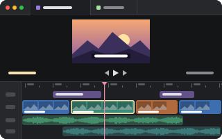

# video-editor

<p align="center"></p>

A video in a tab: Clipkit's timeline editor, over a project file that is the edit. The project is
JSON (CKP/1.0), and the media it names sits beside it, so an agent can read the cut, write a new
one, and see it on the timeline the moment it is saved.

```sh
pumi plugin add pumi-dev/plugins/video-editor
pumi call pumi_dev.video_editor.open '{"path":"take.ckp.json"}'
```

The tab opens beside the one you are in (`{"split":"down"}` for below it). The page is drawn in a
web view, so it is macOS only for now.

## The project

The project file is the edit: clips, tracks, their placement, and the media's paths relative to the
project's folder. Everything it names — the video, the audio, the stills — is served from that
folder, so a `source` of `take.mp4` is the file beside the JSON.

- **Saved on every edit**, `300 ms` after the last change, and the whole file at once: it is written
  beside the project and renamed over it, so a reader never sees half an edit.
- **Written by someone else**: when the file on disk becomes something the page did not write — an
  agent rewrote it, a script regenerated it — the tab opens the new version in place of the old.
- **Agents write the JSON**, not the UI: the timeline is a view of the file, and the file is the
  cut.

## What it needs

Nothing but pumi. The editor's page is bundled from the plugin's own dependencies into `web/` the
first time a project opens (a tenth of a second), and again when the page or Clipkit changes; its
workers are built beside it. Nothing is fetched from the network at run time, and the page, the
project and the media stay on `127.0.0.1`.

## The tab

| | |
| --- | --- |
| block | `pumi_dev.video_editor.editor`, drawn by `src/ui.tsx`'s `Editor` |
| option | `project`: the project file this tab edits, set when the tab opens |
| title | the project's name, without its extension |

`pumi_dev.video_editor.open` takes `path`, and `split` (`right`, `down`, `left`, `up`); it answers
the tab's id. A relative path is from the calling tab's folder.

Space and the arrows go to the editor (play, step a frame), as do `cmd+z` and `cmd+shift+z`: the
window's own bindings do not take them while the tab has the keyboard.

## Working on it

```sh
bun install
bun run check                  # the worker and the window, then the page
bun run build                  # build web/ now, as the plugin does at first use
pumi plugin dev video-editor   # link it, reload on save
```

- `src/main.ts` runs in the plugin's worker: it opens tabs, starts a page server per project
  (`src/serve.ts`) and builds the page (`src/page.ts`).
- `src/serve.ts` is the project's server, and pure: `bun src/serve.ts take.ckp.json` prints the
  address, and a browser can open it.
- `src/ui.tsx` is the window's half: a `<WebView>` on that address, with the project and its media
  on the other side of it.
- `page/` is the page itself, Clipkit's editor over the project the server serves beside it.
